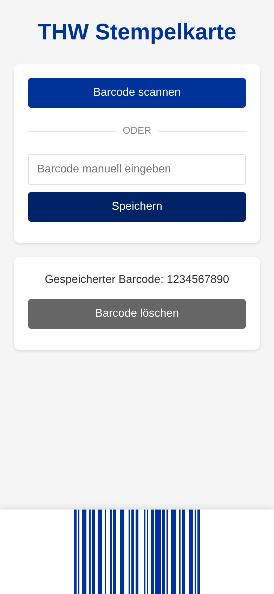

# THW Stempelkarte

Der Barcode zum Einstempeln im eigenen Ortsverband. Ein kleiner Drop-In-Ersatz für die alte THW-Aktuell-App.

**[thw.janosch-bl.de](https://thw.janosch-bl.de)**

Ich bin selbst beim THW und habe mich ziemlich darüber aufgeregt, dass die [THW-Aktuell-App](https://play.google.com/store/apps/details?id=de.thw.ovcmsapp&hl=de) bei mir nicht mehr funktioniert und keine Updates mehr bekommt. Den Barcode zum Einstempeln im Ortsverband fand ich aber halt praktisch.

Also habe ich mir den Teil kurzerhand selbst geschrieben und dann einfach veröffentlicht. Ich wollte eigentlich nur wieder meinen Barcode auf dem Handy haben.

- Barcode einmal scannen oder eintippen
- Über "Zum Startbildschirm hinzufügen" wie eine App nutzen
- Nach dem ersten Laden läuft alles lokal und ohne Internet. Der Barcode bleibt auf dem Handy.
